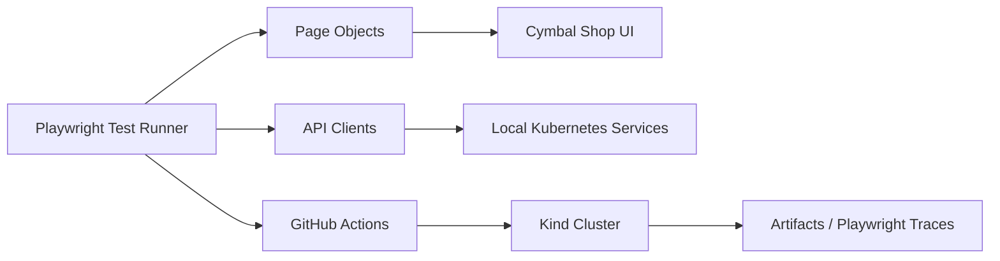

# CymbalShop E2E Test Suite

[](https://github.com/siddharth-builds/CymbalShop-E2E-TestSuite/actions/workflows/playwright.yml)

A production-grade Playwright and TypeScript automation suite designed to validate the Google Cloud Online Boutique (Cymbal Shop) across real end-to-end user journeys, API behavior, and distributed microservice interactions.

This project was built to catch regressions before they reach production by testing revenue-critical flows, session consistency, pricing logic, and service-to-service behavior in an isolated Kubernetes-based environment.

---

## Why this project exists

Modern e-commerce experiences are backed by many moving parts: product catalogs, carts, pricing services, checkout flows, and user state. This suite helps verify that those systems work together correctly.

It focuses on:
- End-to-end purchase validation
- Stateful cart logic and persistence
- Currency and pricing integrity
- API-driven service validation
- CI-gated regression prevention

---

## Tech stack

- Playwright
- TypeScript
- Node.js 24
- Docker
- Kubernetes with Kind
- kubectl
- GitHub Actions
- dotenv

---

## Architecture and design patterns

This framework is intentionally structured for maintainability and scale. Instead of embedding logic into test specs, responsibilities are split across reusable layers:

- Page Object Model (POM): UI selectors and interaction flows are isolated in page classes.
- API Object Model: HTTP logic is wrapped in dedicated API clients.
- Environment configuration: settings are externalized to keep local and CI behavior aligned.
- CI-first execution: tests run in a containerized, ephemeral cluster to improve reproducibility.



---

## Repository structure

```text
.
├── .github/
│   └── workflows/                 # CI pipeline definitions
├── pages/                        # Page Object Model classes
│   ├── CartPage.ts
│   ├── HomePage.ts
│   └── ProductPage.ts
├── tests/
│   ├── api/                      # API client and native API tests
│   │   ├── ProductsApiClient.ts
│   │   ├── UsersApiClient.ts
│   │   ├── products.api.spec.ts
│   │   └── users.api.spec.ts
│   ├── cart.spec.ts             # Stateful cart validation
│   ├── currency.spec.ts         # Currency and session retention checks
│   ├── e2e-checkout.spec.ts     # Full checkout journey
│   └── smoke.spec.ts            # Critical-path smoke checks
├── .env.example                  # Example environment config
├── playwright.config.ts         # Playwright configuration
├── package.json                 # Dependencies and scripts
├── README.md                    # Project documentation
└── tsconfig.json
```

---

## Business impact

The suite is designed to validate real business behavior, not just happy-path rendering.

- Revenue Protection: verifies the end-to-end checkout flow, including card validation and purchase completion
- Session Reliability: ensures cart state and pricing remain consistent across user interactions
- Localization Integrity: validates dynamic price symbols and region-specific behavior
- Shift-Left API Validation: checks backend routes and responses without relying solely on browser rendering

These tests are intended to reduce the risk of customer-facing regressions in a distributed system.

---

## Prerequisites

Before running the suite locally, make sure the following are installed and working:

- Node.js 24+
- Docker Desktop
- Kind
- kubectl

---

## Quick start

Clone the repository:

```bash
git clone https://github.com/siddharth-builds/CymbalShop-E2E-TestSuite.git
cd CymbalShop-E2E-TestSuite
```

Install dependencies:

```bash
npm install
```

Install Playwright browsers:

```bash
npx playwright install --with-deps
```

Start the required local services or environment setup if your project relies on the Kind cluster or Dockerized app stack.

Run the smoke suite:

```bash
npx playwright test --grep "@smoke"
```

Or run the full suite:

```bash
npx playwright test
```

> If the project defines custom package scripts in `package.json`, prefer those for the repo’s supported workflow.

---

## Local execution workflow

A typical local test flow looks like this:

1. Start Docker
2. Provision the local Kubernetes environment
3. Wait for all services to report healthy
4. Run targeted smoke tests
5. Run the broader UI/API suite
6. Review Playwright reports and traces on failure

This setup helps ensure the suite mirrors the conditions under which real microservice behavior is validated.

---

## CI/CD and automation

The project is built for automated validation in GitHub Actions. The pipeline is designed to:

- Provision an isolated kind cluster
- Wait for service readiness
- Execute smoke and integration tests
- Capture failure artifacts
- Upload Playwright HTML reports and traces for debugging
- Enforce quality gates before release

This approach reduces flakiness, improves reproducibility, and accelerates feedback for developers.

---

## Testing approach

The framework combines multiple test layers:

- UI tests using Playwright
- API tests using native request contexts
- State-based validation for carts and sessions
- Cross-service checks for pricing and checkout logic

This layered approach makes it easier to determine whether a failure is caused by:
- UI rendering
- backend response shape
- service orchestration
- state persistence issues

---

## Troubleshooting

Common issues you may encounter:

### Docker or Kubernetes is not running
Ensure Docker Desktop is started and the local engine is healthy before creating any cluster resources.

### Kind cluster is not ready
Wait for services to finish bootstrapping before executing browser tests. You may need to retry or inspect cluster health with `kubectl`.

### Playwright browsers are missing
Run:

```bash
npx playwright install
```

### Test environment variables are not loaded
Check your `.env` file or config setup and confirm all required values are present.

### Failures show as flaky or timing-related
Verify:
- service readiness
- cluster health
- expected mock or backend data state
- test isolation and cleanup between runs

---

## Contributing

Contributions are welcome. If you are extending the framework:

- keep tests readable and focused
- prefer reusing page objects and API clients
- isolate environment-specific logic
- add clear assertions around business behavior
- preserve deterministic test setup and teardown

---

## License

This project is provided for testing and automation use within the repository context. Add a license file if you want to define explicit usage terms for broader distribution.

---

## Summary

This repository is a practical, test-first validation layer for a microservices-based storefront. It gives you a reliable way to catch regressions in user flows, backend contract behavior, and distributed state transitions before they affect customers.

---

## Need to scale this for production?
Running tests locally is easy. Scaling them in CI/CD is hard.
Get the Pro Playwright Boilerplate to unlock:

Automated ephemeral Kubernetes (Kind) clusters in GitHub Actions

Dockerized execution environments

Gemini 1.5 API scripts for automated log triage

Get the Pro Boilerplate on Gumroad
